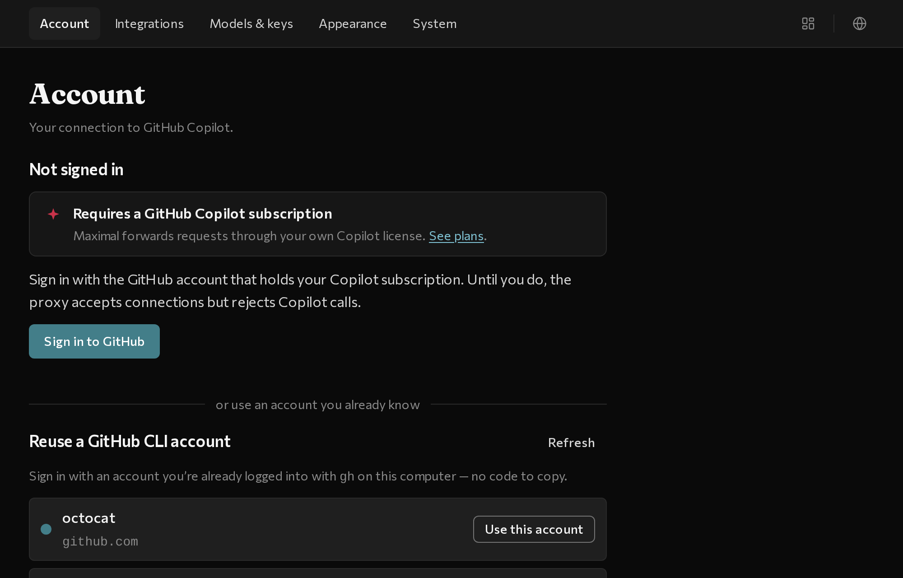

# Connect GitHub Copilot

Before your coding tools can use your GitHub Copilot models, sign in to GitHub once on the **Account** tab.

## Sign in on the Account tab

When you open maximal for the first time, it opens directly to the **Account** tab. Pick whichever sign-in option is easiest for you:

### Option 1: Reuse an existing GitHub CLI login (one click)

If you already use the `gh` command-line tool on your computer, your GitHub username appears automatically under **Reuse a GitHub CLI account**:

1. Click **Use this account** next to your username (or click **Refresh** if you just signed in to `gh`).
2. maximal connects immediately&mdash;no browser code needed.

### Option 2: Sign in with a browser code

1. Click **Sign in to GitHub**.
2. Click **Copy `<CODE>` and open GitHub** to copy the 8-character code and open GitHub in your browser.
3. Paste the code on GitHub and approve. maximal switches to **Connected** automatically.

## Confirm you are connected

Once signed in, the **Account** tab shows your GitHub username and a `⇄` **Connected** status next to the GitHub Copilot icon.

## Switch between multiple GitHub accounts

If you have both a personal and a work GitHub account, you can keep both saved under **Switch to**:

- **Add another account:** click **Use another account** and sign in.
- **Switch accounts:** click **Switch** next to any saved account. Your tools will use that account on their next request.
- **Sign out or Remove:** signing out or removing an account only forgets maximal&rsquo;s own saved login; it never logs you out of your browser or `gh`.

## If Copilot shows a notice

If your GitHub account doesn&rsquo;t have an active Copilot plan, or if you hit a Copilot quota or billing notice, maximal brings you to the **Account** tab and gives you a direct link to resolve it on GitHub.

## Next step

- [Connect your tools](./connect-your-tools) — turn on Claude Code, Claude Desktop, Codex, and Work IQ in **Integrations**.

---

## Want to know a bit more?

- **Terminal sign-in:** if you use the CLI, run `maximal auth` (or `maximal setup` to sign in and run a quick connection test).
- **GitHub Enterprise (`*.ghe.com`):** if your organization uses a custom GitHub Enterprise host with data residency, set `COPILOT_API_ENTERPRISE_URL` in your environment (or `enterpriseUrl` in `~/.config/maximal/config.json`) before signing in.
