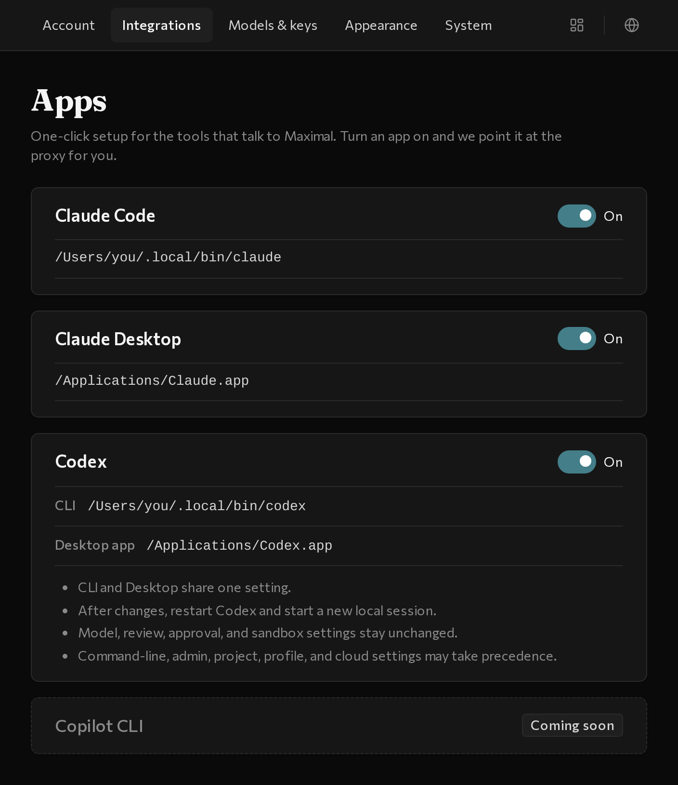

# Connect your tools

In the **Integrations** tab, flip a switch to run your coding apps on your GitHub Copilot plan, and turn on Microsoft **Work IQ** to give Claude Code your Microsoft 365 context.

## 1. Turn on your coding apps

Open maximal and select the **Integrations** tab. Under **Apps**, you&rsquo;ll see switches for the supported tools on your computer:



- **Claude Code** — flip the switch **On**, then open Claude Code and use it normally.
- **Claude Desktop** — flip the switch **On**, then use Claude Desktop (Cowork mode) and its model picker as usual.
- **Codex** — flip the switch **On** to set up both the Codex CLI and the **Codex Desktop** app. **Restart Codex and start a new session** after flipping the switch so it picks up the change.

### Good to know

- **If a tool isn&rsquo;t installed yet:** its card shows the install command with a **Copy command** button. Install the tool and maximal notices it by itself; then switch it on.
- **Turning a switch off:** flipping a switch **Off** returns that app to its previous settings.
- **If an app already has custom settings:** maximal won&rsquo;t overwrite existing custom gateway settings&mdash;instead, the card tells you what conflicted so you can clear it first.

---

## 2. Turn on Work IQ

Microsoft **Work IQ** lets your coding assistant look up context from your Microsoft 365 account: mail, meetings, chats, files, and people. It&rsquo;s built into maximal as a **connector**, so there&rsquo;s nothing else to install.

You&rsquo;ll need a Microsoft 365 work or school account with a Microsoft 365 Copilot license, and your organization must have approved Work IQ.

1. In the **Integrations** tab, scroll to **Connectors** and open **Work IQ**.
2. Flip the switch **On**.
3. Click **Accept terms** after reviewing Microsoft&rsquo;s Work IQ terms.
4. Click **Sign in**. Your browser opens Microsoft&rsquo;s sign-in page; finish there within 5 minutes and come back to maximal. The status changes to **Connected as** your account, and maximal sends a notification that Work IQ is connected.
5. Under **Connect to apps**, check **Claude Code**, then start a new Claude Code session.

Claude Code needs to be switched on under **Apps** first. If Claude Code already has its own Work IQ set up, maximal tells you on the Work IQ page and doesn&rsquo;t add a second one.

maximal keeps your sign-in encrypted, with the key in your system&rsquo;s credential store (Keychain on macOS, Credential Manager on Windows, or your desktop keyring on Linux), so you stay signed in after maximal restarts. Turning Work IQ **Off** removes its tools from your apps but keeps your sign-in and your choices.

---

## 3. Choose what Work IQ may do

Under **Tool permissions** on the Work IQ page, choose how each tool can be used. Tools are grouped into **Read-only tools**, **Write/delete tools**, and **Other tools**; set a whole group at once or each tool on its own:

- **Allowed** — your apps can use the tool.
- **Asks** — you approve every call. Claude Code asks you itself before the tool runs.
- **Blocked** — the tool stays listed in your apps but is turned off, and calls are refused.

By default, read-only tools are allowed, deleting is blocked, and everything else asks.

---

## Want to know a bit more?

- **Where settings are written:** flipping on an app updates `~/.claude/settings.json` (Claude Code), Claude Desktop&rsquo;s local gateway settings, or `~/.codex/config.toml` (Codex CLI and Desktop), and provisions a dedicated local API key for each app. Checking **Claude Code** for Work IQ adds a `maximal-workiq` server to `~/.claude.json`.
- **Work IQ in other apps:** for any other app that supports MCP servers, copy the address shown under **Connect to apps** and add it as a server, with a key from **Integrations → API keys**. Apps that can&rsquo;t ask for approval, like Codex, can only use tools set to **Allowed**.
- **Connecting `opencode` or custom scripts:** in the **Integrations** tab, copy maximal&rsquo;s local address from **Endpoint** (`http://127.0.0.1:4141` for Anthropic-style tools or `http://127.0.0.1:4141/v1` for OpenAI-style tools) and click **+ Add a connection** under **API keys** to create a named key.
- **Command-line equivalents:** if you installed the CLI, you can toggle apps from the terminal:
  ```sh
  maximal app list
  maximal app claude-code --enable
  maximal app claude-desktop --enable
  maximal app codex --enable
  ```
