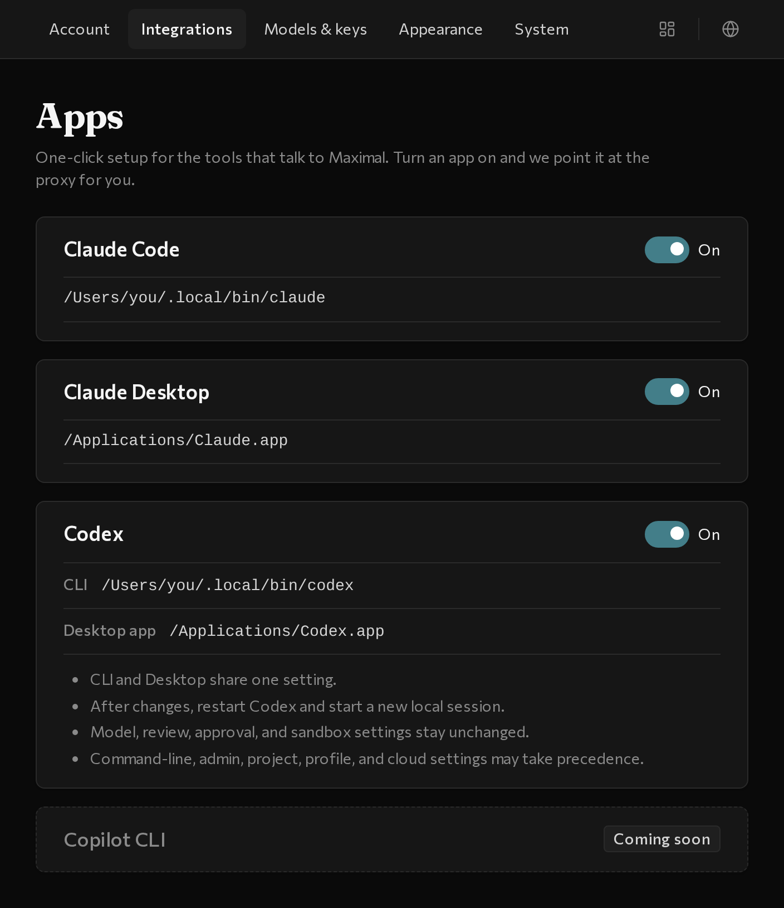
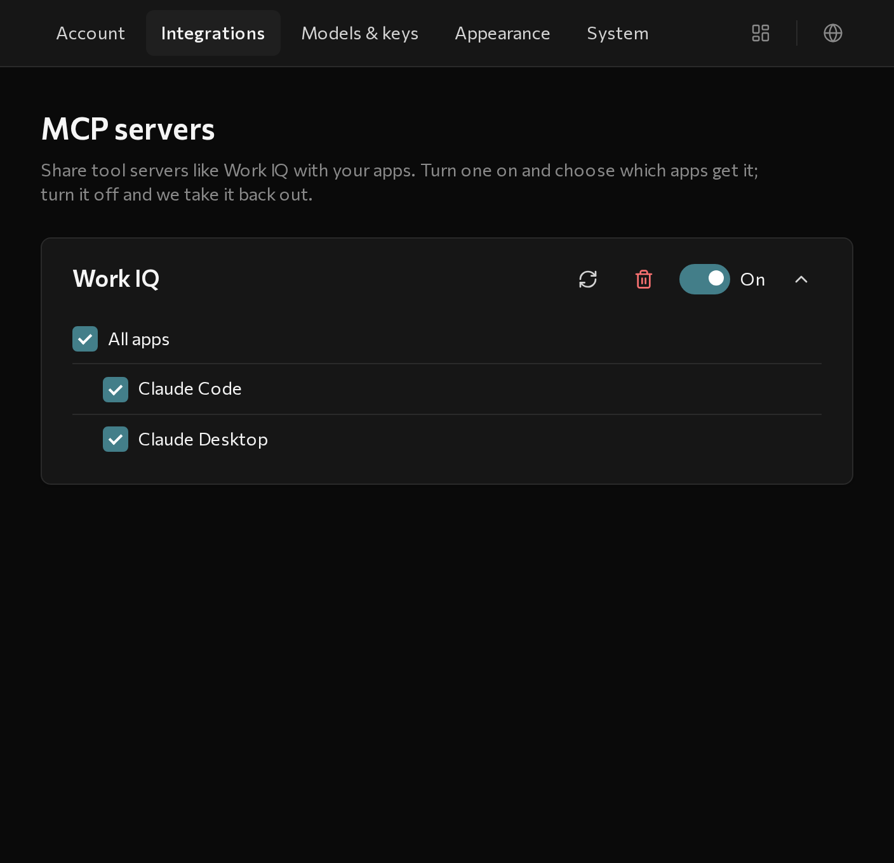
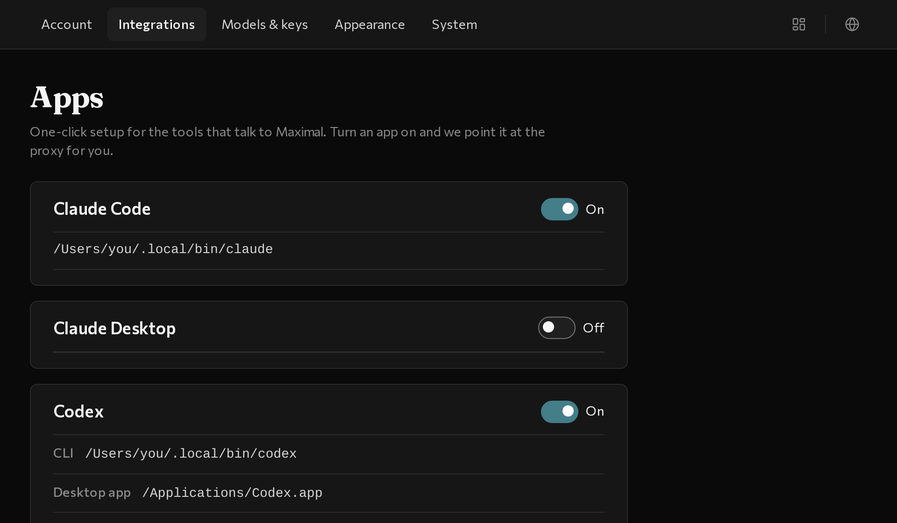
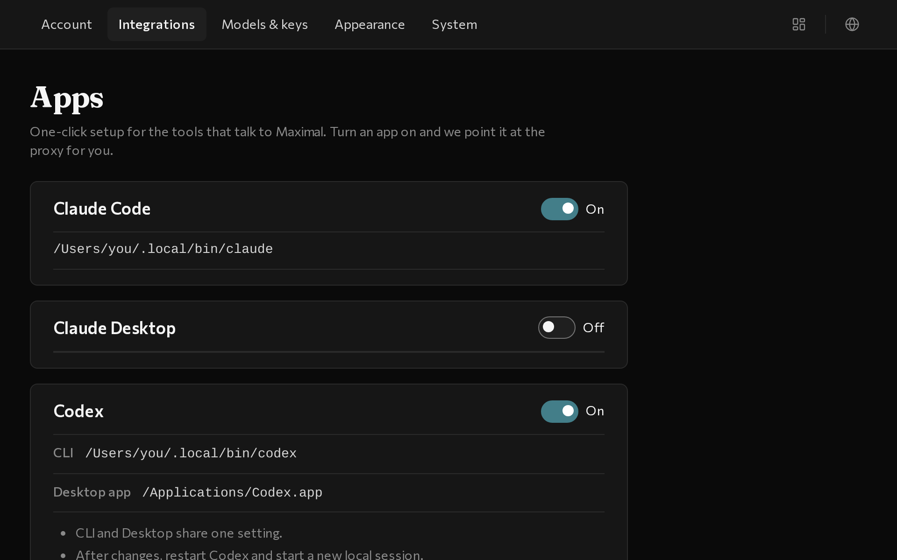
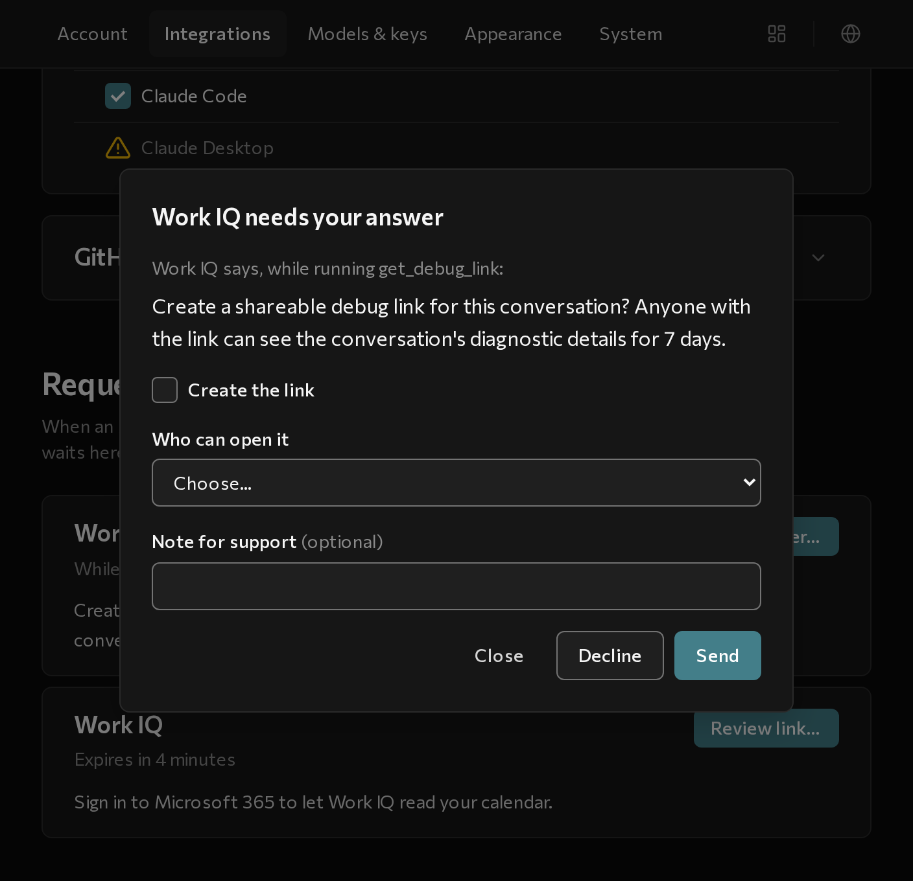

# Connect your tools

In the **Integrations** tab, flip a switch to run your coding apps on your GitHub Copilot plan and share Microsoft **Work IQ** across your apps.

## 1. Turn on your coding apps

Open maximal and select the **Integrations** tab. Under **Apps**, you&rsquo;ll see switches for the supported tools on your computer:



- **Claude Code** — flip the switch **On**, then open Claude Code and use it normally.
- **Claude Desktop** — flip the switch **On**, then use Claude Desktop (Cowork mode) and its model picker as usual.
- **Codex** — flip the switch **On** to set up both the Codex CLI and the **Codex Desktop** app. **Restart Codex and start a new session** after flipping the switch so it picks up the change.

### Good to know

- **If a tool isn&rsquo;t installed yet:** its card shows the install command with a **Copy command** button. Install the tool, then click **Re-scan**.
- **Turning a switch off:** flipping a switch **Off** returns that app to its previous settings.
- **If an app already has custom settings:** maximal won&rsquo;t overwrite existing custom gateway settings&mdash;instead, the card tells you what conflicted so you can clear it first.

---

## 2. Turn on Work IQ (MCP servers)

Microsoft **Work IQ** lets your coding assistant look up context from your Microsoft 365 account (emails, calendar events, Teams messages, SharePoint docs, and OneDrive files).

Instead of setting up Work IQ separately in every app, you can turn it on once in **Integrations → MCP servers** (available on macOS and Linux):



1. Scroll to **MCP servers** in the **Integrations** tab and look under **Available to add**:
   - **If Work IQ isn&rsquo;t installed yet:** click **Copy command** on the Work IQ card, run the command in your terminal, and click **Re-scan**.
   - **Once Work IQ is found:** click **Add** and confirm.



2. Flip the **Work IQ** switch **On**.
3. Check the apps that should get it (**All apps**, **Claude Code**, or **Claude Desktop**).

---

## 3. Answer prompts in Requests

Sometimes Work IQ (or another MCP server) asks you to fill out a quick form or review a sign-in link during a task. When an app like Claude Desktop can&rsquo;t show that prompt on its own, maximal catches it under **Integrations → Requests** and sends you a notification:



1. Open **Integrations → Requests** (or click **Answer requests…** from maximal&rsquo;s menu bar or Dock icon).
2. Click **Answer…** (to fill out a form) or **Review link…** (to open a sign-in link), or click **Decline** before the 5-minute timer expires.



---

## Want to know a bit more?

- **Where settings are written:** flipping on an app updates `~/.claude/settings.json` (Claude Code), Claude Desktop&rsquo;s local gateway settings, or `~/.codex/config.toml` (Codex CLI and Desktop), and provisions a dedicated local API key for each app.
- **Connecting `opencode` or custom scripts:** open the **Models & keys** tab to copy maximal&rsquo;s local address (`http://127.0.0.1:4141` for Anthropic-style tools or `http://127.0.0.1:4141/v1` for OpenAI-style tools) and click **+ Add a connection** under **API keys** to create a named key.
- **Command-line equivalents:** if you installed the CLI, you can toggle apps and MCP servers from the terminal:
  ```sh
  maximal app list
  maximal app claude-code --enable
  maximal app claude-desktop --enable
  maximal app codex --enable

  maximal mcp workiq --add
  maximal mcp workiq --enable
  ```
