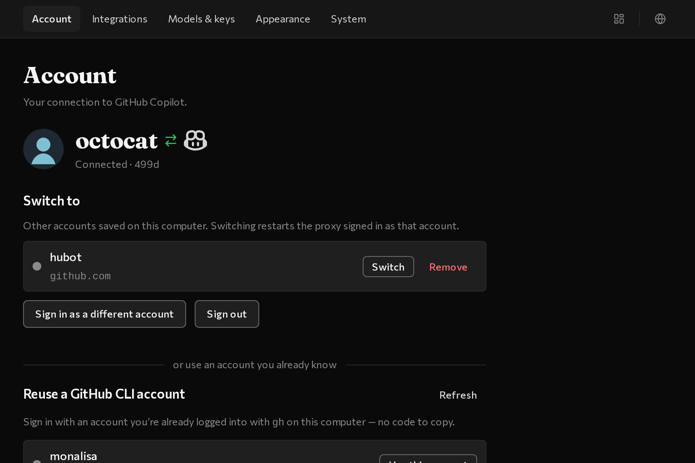
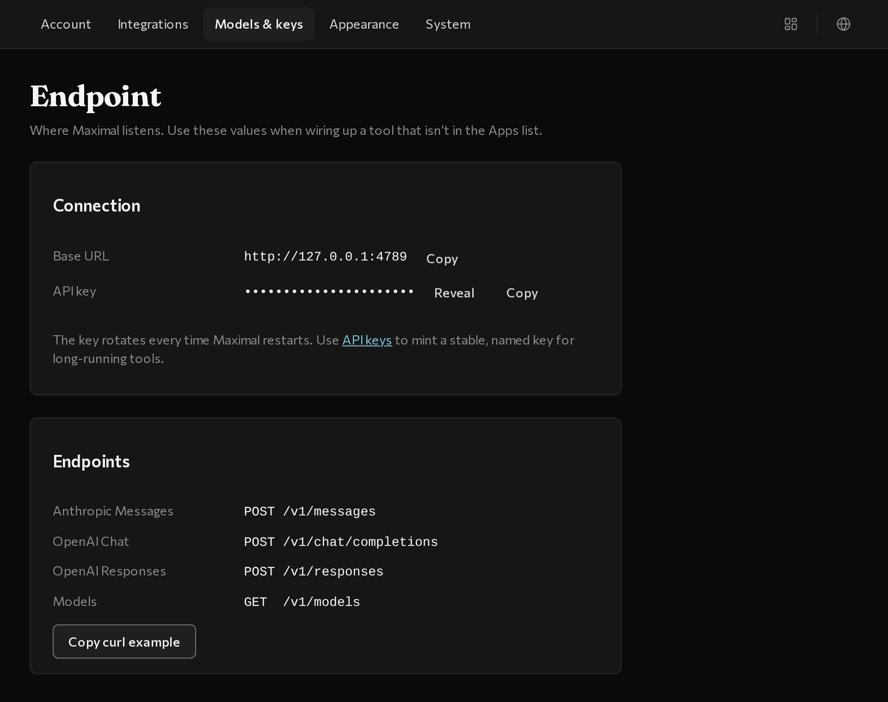
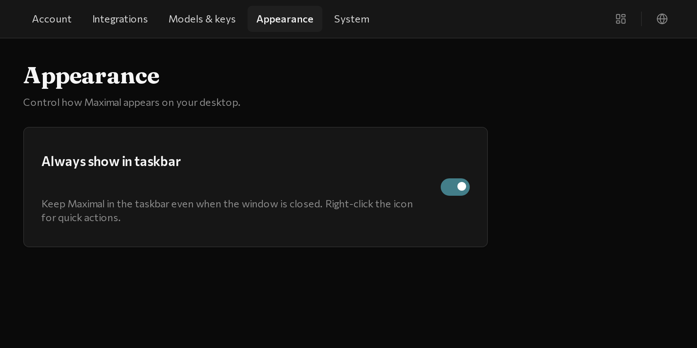
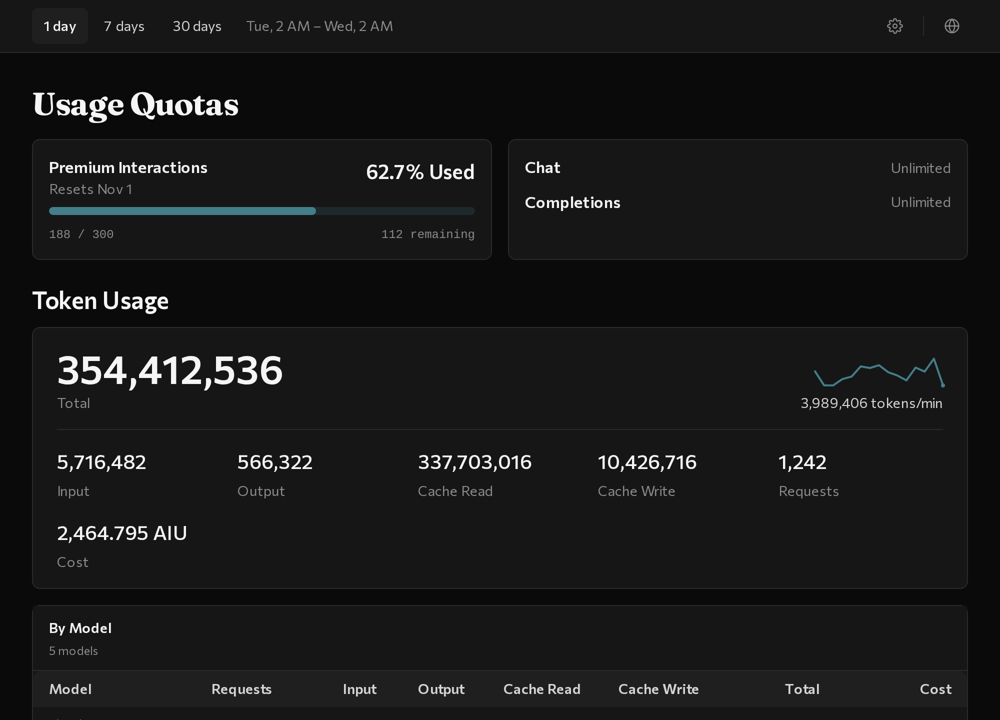

# Usage and settings

maximal puts all of your settings and your usage dashboard in a single window.

Across the top bar:

- **Five Settings tabs on the left:** **Account**, **Integrations**, **Models & keys**, **Appearance**, and **System**.
- **Dashboard toggle on the right:** click the chart icon (or press `⌘D` on macOS or `Ctrl+D` on Windows) to view your usage dashboard; click the gear icon (or press `⌘,` or `Ctrl+,`) to return to Settings.
- **Language menu:** click the globe icon in the top-right corner to switch between 12 languages.

---

## Account

Sign in to GitHub Copilot and switch between saved GitHub accounts.

- **Reuse a GitHub CLI account** — connect an existing `gh` login in one click.
- **Sign in to GitHub** — connect using an 8-character browser code.
- **Switch to** — swap between saved personal and work GitHub accounts.
- **Status and notices** — shows your active Copilot connection and surfaces any quota or billing notices from GitHub with a direct link to fix them.

---

## Integrations

Turn on your coding apps, share **Work IQ** and other MCP servers, and answer server prompts.

- **Apps** — one-click switches for **Claude Code**, **Claude Desktop**, and **Codex** (plus copyable install commands if a tool isn&rsquo;t installed yet).
- **MCP servers** — add and turn on **Work IQ** (or other local MCP servers) and choose whether **Claude Code**, **Claude Desktop**, or **All apps** receive them.
- **Requests** — holds form or sign-in link prompts from MCP servers when an app like Claude Desktop can&rsquo;t show them directly.

---

## Models and keys

Browse the models included in your Copilot plan, or grab the local address and API keys for manual tools.

- **Models** — lists every model available in your GitHub Copilot plan, grouped by family, with capability badges (`Vision`, `Tools`, `Streaming`, `Reasoning`) and token limits.
- **Endpoint and API keys** — only needed if you&rsquo;re connecting a tool manually (like `opencode` or your own scripts). Copy the local address from **Endpoint** and click **+ Add a connection** under **API keys** to create a named key.

---

## Appearance

Control how maximal appears on your desktop.

- **Always show in Dock / taskbar** — on by default so maximal stays visible in your Dock or taskbar even when the window is closed. Turn it off if you only want maximal in your menu bar or system tray.
- **Theme** — follows your system light or dark mode automatically.

---

## System

Helpful when troubleshooting or reporting an issue.

- **Diagnostics** — a summary of your version and configuration with all secrets hidden, safe to copy into a bug report.
- **Logs** — a button to open the request log folder in Finder or Explorer.
- **Uninstall** — cleanly removes maximal&rsquo;s background service and app settings.

---

## Usage Dashboard (`⌘D` / `Ctrl+D`)

Click the chart icon in the top-right corner to check your Copilot quotas and token usage:

- **Time range (`1 day`, `7 days`, `30 days`)** — switch the window at the top of the screen.
- **Usage Quotas** — see how much of your monthly GitHub Copilot *Premium Interactions* quota is used, how many interactions remain, and when it resets.
- **Token Usage and By Model** — see your live `tokens/min` rate and token counts broken down by model.
